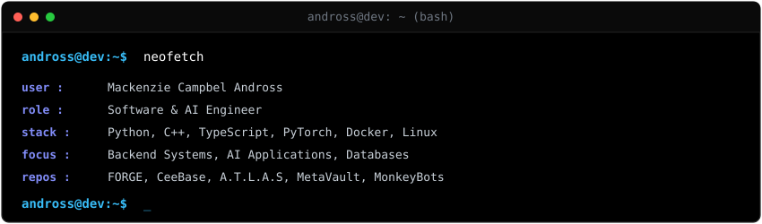
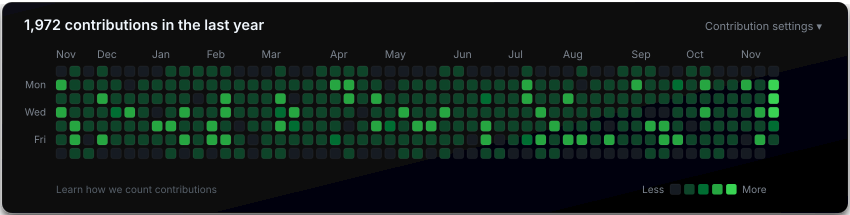

  

<h1 align="center">Hi, I'm Mackenzie</h1>

  

---

<h2 align="center">About Me</h2>

Hey, I'm **Mackenzie**.

Most of my days are spent building backends, experimenting with AI, and writing low-level code in **Python and C++**. I like understanding systems from the ground up and building tools that are clean under the hood.

Outside of software engineering, I am an International Chess Player.

 

---

<h2 align="center">Contribution Activity</h2>

  

---

<h2 align="center">Featured Systems</h2>

  

   
  <blockquote>
    
<b>FORGE &mdash; Autonomous Multi-Agent Workflow Framework</b>

    
Asynchronous task graph execution engine featuring automated dependency resolution, worker isolation, and dynamic schema generation.

    <ul>
      <li><b>Architecture:</b> DAG-based task orchestration with cycle detection and parallel branch execution</li>
      <li><b>Fault Tolerance:</b> Automated retry policies, checkpointing, and execution state recovery</li>
      <li><b>Stack:</b> Python, AsyncIO, Docker SDK, Alembic, PostgreSQL</li>
    </ul>
    
<a href="https://github.com/MackenzieCampbelAndross/FORGE"><b>View Repository &rarr;</b></a>

  </blockquote>

 

  

   
  <blockquote>
    
<b>CeeBase &mdash; Embedded Key-Value Storage Engine</b>

    
High-performance embedded key-value storage engine in C++17 with disk-backed persistence.

    <ul>
      <li><b>Storage Engine:</b> Page-based disk layout with slotted pages and buffer pool manager using clock replacement</li>
      <li><b>Indexing &amp; Recovery:</b> Concurrent B+ Tree indexing and Write-Ahead Logging (WAL) for ACID crash consistency</li>
      <li><b>Stack:</b> C++17, CMake, POSIX I/O, GoogleTest</li>
    </ul>
    
<a href="https://github.com/MackenzieCampbelAndross/CeeBase"><b>View Repository &rarr;</b></a>

  </blockquote>

 

  

   
  <blockquote>
    
<b>A.T.L.A.S &mdash; Real-Time Voice Processing Pipeline</b>

    
Low-latency audio intelligence pipeline designed for real-time speech processing and natural language interaction.

    <ul>
      <li><b>Audio DSP:</b> Real-time noise suppression, acoustic framing, and Voice Activity Detection (VAD)</li>
      <li><b>Inference Engine:</b> Streaming Whisper speech-to-text decoding paired with zero-shot intent extraction</li>
      <li><b>Stack:</b> Python, Whisper, PyTorch, Librosa, WebSockets</li>
    </ul>
    
<a href="https://github.com/MackenzieCampbelAndross/A.T.L.A.S"><b>View Repository &rarr;</b></a>

  </blockquote>

 

  

   
  <blockquote>
    
<b>MetaVault &mdash; Decentralized KYC &amp; Identity Registry</b>

    
Smart contract protocol for on-chain identity verification and revocable Soulbound Token (SBT) attestations.

    <ul>
      <li><b>Identity Architecture:</b> EIP-712 typed structured data signing for off-chain credential verification</li>
      <li><b>Security &amp; Gas:</b> Role-based access control, gas-optimized storage slots, and non-transferable SBT checks</li>
      <li><b>Stack:</b> Solidity, Hardhat, Ethers.js, OpenZeppelin, Web3</li>
    </ul>
    
<a href="https://github.com/MackenzieCampbelAndross/MetaVault"><b>View Repository &rarr;</b></a>

  </blockquote>

 

  

   
  <blockquote>
    
<b>MonkeyBots &mdash; Headless Browser Automation Framework</b>

    
High-throughput web extraction and automation engine with anti-detection evasion and session management.

    <ul>
      <li><b>Browser Orchestration:</b> Automated session lifecycle renewal, proxy rotation, and fingerprint masking</li>
      <li><b>Extraction Engine:</b> Resilient DOM mutation tracking, asynchronous page evaluation, and structured data streaming</li>
      <li><b>Stack:</b> Python, Playwright, AsyncIO, BeautifulSoup4, Redis</li>
    </ul>
    
<a href="https://github.com/MackenzieCampbelAndross/MonkeyBots"><b>View Repository &rarr;</b></a>

  </blockquote>

 

  

   
  <blockquote>
    
<b>AstraLink &mdash; Free-Space Optical Communications (FSOC) 3D Simulator</b>

    
Interactive 3D simulation engine modeling inter-satellite laser communications and ground optical links.

    <ul>
      <li><b>Simulation Physics:</b> Orbital mechanics calculation, atmospheric turbulence attenuation, and laser beam pointing vectors</li>
      <li><b>Visualization:</b> Real-time Three.js 3D rendering with dynamic telemetry metrics and ground-station line-of-sight tracking</li>
      <li><b>Stack:</b> TypeScript, Three.js, Vite, WebGL, TailwindCSS</li>
    </ul>
    
<a href="https://github.com/MackenzieCampbelAndross/AstraLink"><b>View Repository &rarr;</b></a>

  </blockquote>

---

<h2 align="center">Connect</h2>

  
  &nbsp;&nbsp;&nbsp;
  
  &nbsp;&nbsp;&nbsp;
  

---

<h2 align="center">Tech Stack</h2>

  

  
  &nbsp;&nbsp;&nbsp;
  
  &nbsp;&nbsp;&nbsp;
  
  &nbsp;&nbsp;&nbsp;
  
  &nbsp;&nbsp;&nbsp;
  

---

<h2 align="center">GitHub Stats</h2>

  

 

<h2 align="center">Activity Graph</h2>

  

