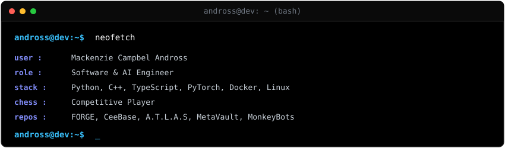

  

<h1 align="center">Hi, I'm Mackenzie</h1>

<h3 align="center">AI Engineer · Systems Builder · Competitive Chess Player</h3>

  

  Building reliable, high-throughput systems with clean architecture and first-principles design.

  
  
  

---

<h2 align="center">// ABOUT ME</h2>

**Mackenzie Campbel Andross** — an **AI & Systems Engineer** focused on designing, developing, and deploying intelligent, high-throughput software systems.

My work revolves around **Autonomous Agents, Applied AI, Computer Vision, Low-Latency C++ Storage Engines, and Distributed Architecture**.

I enjoy working across the entire engineering lifecycle: from mathematical problem formulation and algorithm design to bare-metal systems optimization, model inference, and resilient production infrastructure.

When I am not writing code, I am an **International Competitive Chess Player**, applying the same principles of deep tactical calculation, positional pattern recognition, and long-horizon strategy to software architecture.

 

---

<h2 align="center">// PIXEL COMPANIONS</h2>

  
  &nbsp;&nbsp;&nbsp;&nbsp;&nbsp;&nbsp;&nbsp;&nbsp;
  
  &nbsp;&nbsp;&nbsp;&nbsp;&nbsp;&nbsp;&nbsp;&nbsp;
  

  <i>Level 99 Digital Companions patrolling the codebase.</i>

---

<h2 align="center">// FEATURED SYSTEMS</h2>

<table width="100%">
<tr>
<td width="50%" valign="top">

### [FORGE](https://github.com/MackenzieCampbelAndross/FORGE)
**Autonomous Multi-Agent Orchestration Platform**
* Distributed asynchronous task DAG execution engine with topological dependency resolution.
* Inter-agent protocol bus, structured telemetry streaming, and isolated worker concurrency pools.
* Episodic vector memory layer and dynamic tool schema registration.

`Python` `AsyncIO` `Alembic` `Docker` `Pydantic v2`

</td>
<td width="50%" valign="top">

### [CeeBase](https://github.com/MackenzieCampbelAndross/CeeBase)
**Embedded Low-Latency Storage Engine**
* Relational storage core written in modern C++ with slotted-page tuple encoding.
* Concurrent B+ Tree indexing with optimistic latch crabbing to prevent thread starvation.
* Atomic Write-Ahead Logging (WAL) with strict fsync checkpointing and LRU buffer frame management.

`C++17` `CMake` `B+ Tree` `WAL` `Memory-Mapped I/O`

</td>
</tr>

<tr>
<td width="50%" valign="top">

### [A.T.L.A.S](https://github.com/MackenzieCampbelAndross/A.T.L.A.S)
**Multimodal Voice & Audio Intelligence**
* Low-latency voice processing pipeline integrating Whisper speech-to-text token decoding.
* Dynamic Voice Activity Detection (VAD) energy gating with ambient noise suppression.
* Intent classifier, hotword activation, and conversational session context persistence.

`Python` `Whisper` `Audio DSP` `VAD` `NLP Intent Engine`

</td>
<td width="50%" valign="top">

### [MetaVault](https://github.com/MackenzieCampbelAndross/MetaVault)
**Zero-Knowledge KYC & Soulbound Identity**
* On-chain cryptographic identity verification registry using EIP-712 typed signatures.
* Soulbound non-transferable token (SBT) status checks with verifiable claim revocation.
* Gas-optimized EVM storage slot packing and proxy upgradeability architecture.

`Solidity` `Hardhat` `zk-SNARKs` `EIP-712` `Web3.js`

</td>
</tr>

<tr>
<td colspan="2" valign="top">

### [MonkeyBots](https://github.com/MackenzieCampbelAndross/MonkeyBots)
**Distributed Headless Automation & Web Agent Fleet**
* Resilient headless browser worker fleet with automated session renewal and proxy pool health routing.
* Dynamic DOM mutation observer fallbacks, anti-bot timing jitter, and structured JSON telemetry extraction.
* Worker concurrency pools with graceful shutdown and automated error screenshot diagnostics.

`Python` `Headless Chrome` `Async Workers` `Resilience Automation`

</td>
</tr>
</table>

---

<h2 align="center">// CONNECT</h2>

  
  &nbsp;&nbsp;&nbsp;
  
  &nbsp;&nbsp;&nbsp;
  

---

<h2 align="center">// TECH STACK</h2>

  

  
  &nbsp;&nbsp;&nbsp;
  
  &nbsp;&nbsp;&nbsp;
  
  &nbsp;&nbsp;&nbsp;
  
  &nbsp;&nbsp;&nbsp;
  

---

<h2 align="center">// GITHUB STATS</h2>

  

 

<h2 align="center">// ACTIVITY GRAPH</h2>

  

---

<h2 align="center">// PHILOSOPHY</h2>

  

  <i>"Understand the problem. Design the system. Build the solution. Measure what matters."</i>

