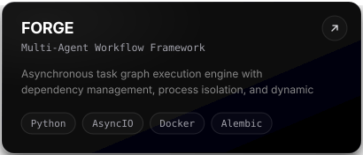
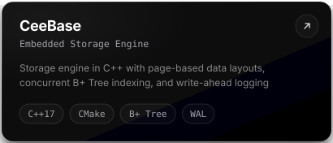
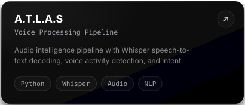
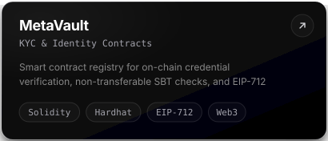
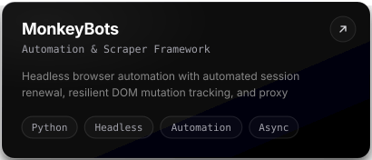

  

<h1 align="center">Hi, I'm Mackenzie</h1>

  

  I build things that run fast and don't break.

---

<h2 align="center">About Me</h2>

Hey, I'm **Mackenzie**.

Most of my days are spent building backends, experimenting with AI, and writing low-level code in **Python and C++**. I like understanding systems from the ground up and building tools that are clean under the hood.

Outside of software engineering, I am an International Chess Player.

 

---

<h2 align="center">Featured Systems</h2>

  

  

  

  

  

---

<h2 align="center">Connect</h2>

  
  &nbsp;&nbsp;&nbsp;
  
  &nbsp;&nbsp;&nbsp;
  

---

<h2 align="center">Tech Stack</h2>

  

  
  &nbsp;&nbsp;&nbsp;
  
  &nbsp;&nbsp;&nbsp;
  
  &nbsp;&nbsp;&nbsp;
  
  &nbsp;&nbsp;&nbsp;
  

---

<h2 align="center">GitHub Stats</h2>

  

 

<h2 align="center">Activity Graph</h2>

  

